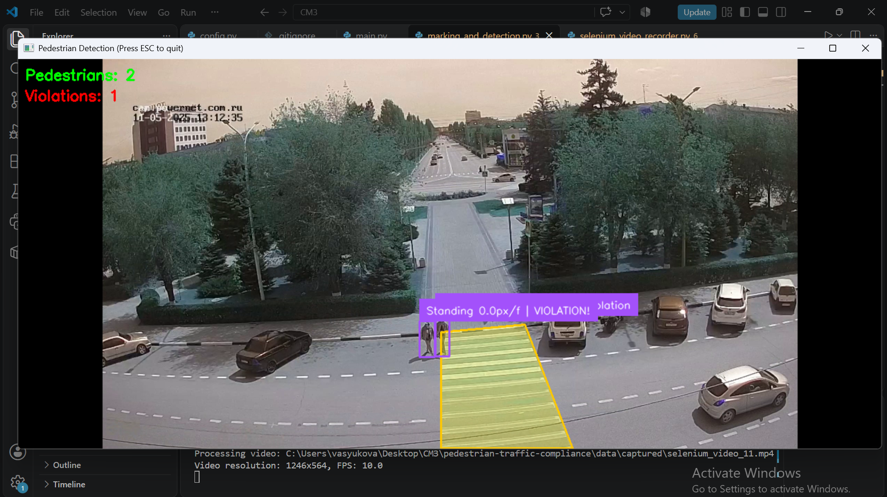
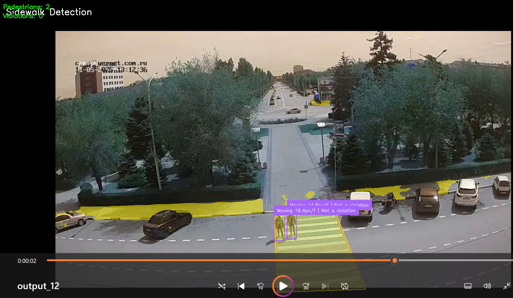

# Детектор пешеходов на пешеходном переходе

Система компьютерного зрения для автоматической детекции нарушителей ПДД на пешеходном переходе.

## Описание
Проект выполняет захват видео с IP-камеры, проводит детекцию пешеходов с помощью YOLOv8 и определяет, находится ли пешеход в зоне пешеходного перехода. Результат визуализируется в реальном времени: нарушения подсвечиваются на видео и логируются в терминале.

## Стек
- Backend: Python, OpenCV, Ultralytics YOLOv8, NumPy
- Захват видео: Selenium (headless-браузер), FFmpeg
- Модели: YOLOv8 (детекция), YOLOv8x-seg (сегментация)

## Функционал системы
- Автоматический захват видео с IP-камеры через веб-плеер (Selenium)
- Детекция пешеходов моделью YOLOv8 в режиме реального времени
- Проверка попадания пешехода в зону пешеходного перехода (полигональная маска)
- Визуализация разметки перехода и bounding-box пешеходов
- Подсветка нарушителей и вывод событий нарушения в терминал
- Поддержка сегментации (YOLOv8x-seg) для более точного определения зоны
- Гибкая настройка: путь к модели, координаты перехода, URL камеры — всё в `config.py`

## Скриншоты

### Детекция с нарушителем

Видео с наложенной разметкой пешеходного перехода и bounding-box пешеходов в момент, когда в кадре присутствует нарушитель (пешеход вне зоны перехода), с соответствующим выводом в терминале.

### Детекция без нарушителя

Представлен результат работы детектора в кадре, где нарушителей нет: все пешеходы находятся в пределах разметки.

## Запуск

1) Установить зависимости:
```
pip install -r requirements.txt
```
2) Убедиться, что модели `yolov8s.pt` / `yolov8x-seg.pt` лежат в `models/`, а в `config.py` заданы корректные `URL` камеры и `crosswalk_coordinates`.
3) Запустить основной пайплайн:
```
python main.py
```
Пайплайн последовательно выполняет: захват видео → детекцию и разметку. Результат сохраняется в `data/detected/output.mp4`.

4) Запустить только захват видео с камеры
```
python -m src.selenium_video_recorder
```
5) Запустить только детекцию (по готовому видео из data/captured/)
```
python -m src.marking_and_detection
```

## Пилот и оценщик

Пилот — сокращённая ветвь с единым порогом уверенности, без размерно-зависимого фильтра; полный адаптивный тракт в пилоте не проверяется. Запуск:

```
python pilot/run_pilot.py     # прогон видео, артефакты в data/pilot/
python pilot/evaluator.py     # синтетические проверки и, при заполненном эталоне, оценка
```

`run_pilot.py` выполняет две сопоставимые выгрузки (baseline и proposed при одинаковых остальных настройках) и сохраняет по каждой покадровые рамки, журнал событий, уведомления, задержки и аннотированное видео.

`evaluator.py` проверяет соответствие реализации определениям события на синтетических трассах (короткое событие, граничная длительность, разрыв трека, отсутствие дублей уведомлений, два события одного человека, пространственный критерий, приоритет длительности, разрешение равенств, конкурирующее назначение, дубли, краткое пересечение, несопоставленное уведомление, фильтр длительности), а также связь «уведомление → событие» через сохранённые CSV. Оценка на независимом эталоне (`REFERENCE_EVENTS` в `pilot/config_pilot.py`) выполняется только при заполненном эталоне; без покадровых рамок эталона она работает в диагностическом режиме без пространственной проверки. Числовые результаты и выводы — в статье.

Синтетические проверки, восстановление сохранённых журналов и оценка по независимому эталону — разные источники результатов; они не подменяют друг друга.

## Структура проекта
```
pedestrian-crosswalk-detector/
├── data/
│ ├── captured/                   # Захваченные видео с камеры
│ ├── detected/                   # Видео с результатами детекции
│ └── pilot/                      # Артефакты пилота
│
├── models/                       # Модели YOLO
│ ├── yolov8s.pt                  # Модель детекции
│ └── yolov8x-seg.pt              # Модель сегментации
│
├── pilot/
│ ├── config_pilot.py             # Параметры пилота и каноническая процедура выбора конфигурации
│ ├── event_log.py                # Журнал событий
│ ├── run_pilot.py                # Прогон пайплайна пилота
│ ├── evaluator.py                # Оценщик
│ ├── stats_bootstrap.py          # Парный блочный бутстрэп
│ └── README.md                   # Документация пилота
│
├── resources/                    # Скриншоты для README
│
├── src/
│ ├── selenium_video_recorder.py  # Захват видео через Selenium
│ └── marking_and_detection.py    # Детекция, разметка перехода, логика нарушений
│
├── main.py                       # Точка входа: пайплайн захват → детекция
├── config.py                     # Пути, URL камеры, координаты перехода
├── requirements.txt
└── README.md                     # Документация проекта
```