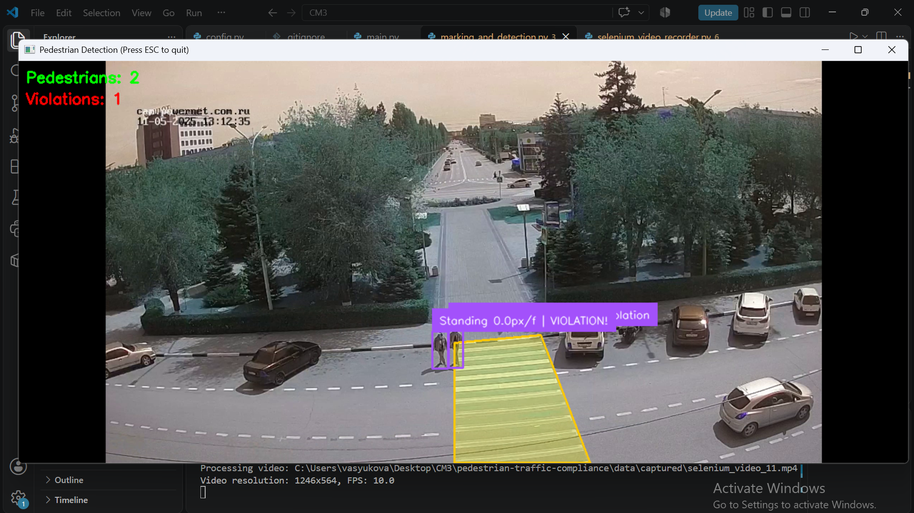
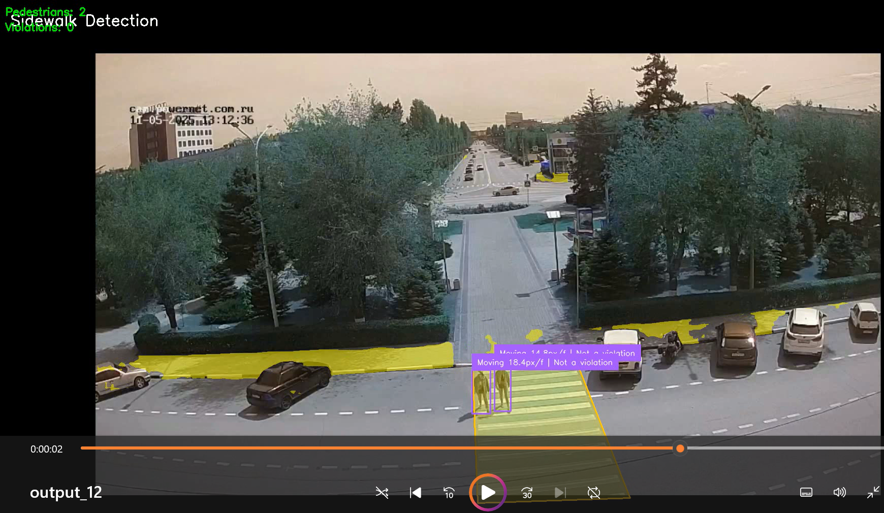

# Детектор пешеходов на пешеходном переходе

Система компьютерного зрения для автоматической детекции нарушителей ПДД на пешеходном переходе.

## Описание
Проект выполняет захват видео с IP-камеры, проводит детекцию пешеходов с помощью YOLOv8 и определяет, находится ли пешеход в зоне пешеходного перехода. Результат визуализируется в реальном времени: нарушения подсвечиваются на видео и логируются в терминале.

## Стек
- Backend: Python, OpenCV, Ultralytics YOLOv8, NumPy
- Захват видео: Selenium (headless-браузер), FFmpeg
- Модели: YOLOv8 (детекция), YOLOv8x-seg (сегментация)

## Функционал системы
- Автоматический захват видео с IP-камеры через веб-плеер (Selenium)
- Детекция пешеходов моделью YOLOv8 в режиме реального времени
- Проверка попадания пешехода в зону пешеходного перехода (полигональная маска)
- Визуализация разметки перехода и bounding-box пешеходов
- Подсветка нарушителей и вывод событий нарушения в терминал
- Поддержка сегментации (YOLOv8x-seg) для более точного определения зоны
- Гибкая настройка: путь к модели, координаты перехода, URL камеры — всё в `config.py`

## Скриншоты

### Детекция с нарушителем

Видео с наложенной разметкой пешеходного перехода и bounding-box пешеходов в момент, когда в кадре присутствует нарушитель (пешеход вне зоны перехода), с соответствующим выводом в терминале.

### Детекция без нарушителя

Представлен результат работы детектора в кадре, где нарушителей нет: все пешеходы находятся в пределах разметки.

## Запуск

1) Установить зависимости:
```
pip install -r requirements.txt
```
2) Убедиться, что модели `yolov8s.pt` / `yolov8x-seg.pt` лежат в `models/`, а в `config.py` заданы корректные `URL` камеры и `crosswalk_coordinates`.
3) Запустить основной пайплайн:
```
python main.py
```
Пайплайн последовательно выполняет: захват видео → детекцию и разметку. Результат сохраняется в `data/detected/output.mp4`.

4) Запустить только захват видео с камеры
```
python -m src.selenium_video_recorder
```
5) Запустить только детекцию (по готовому видео из data/captured/)
```
python -m src.marking_and_detection
```

## Структура проекта
```
pedestrian-crosswalk-detector/
├── data/
│ ├── captured/                   # Захваченные видео с камеры
│ └── detected/                   # Видео с результатами детекции
│
├── models/                       # Модели YOLO
│ ├── yolov8s.pt                  # Модель детекции
│ └── yolov8x-seg.pt              # Модель сегментации
│
├── pilot/
│ ├── config_pilot.py             # Параметры пилота
│ ├── event_log.py                # Журнал событий
│ ├── run_pilot.py                # Прогон пайплайна пилота
│ ├── evaluator.py                # Оценщик
│ └── README.md                   # Документация пилота
│
├── resources/                    # Скриншоты для README
│
├── src/
│ ├── selenium_video_recorder.py  # Захват видео через Selenium
│ └── marking_and_detection.py    # Детекция, разметка перехода, логика нарушений
│
├── main.py                       # Точка входа: пайплайн захват → детекция
├── config.py                     # Пути, URL камеры, координаты перехода
├── requirements.txt
└── README.md                     # Документация проекта
```